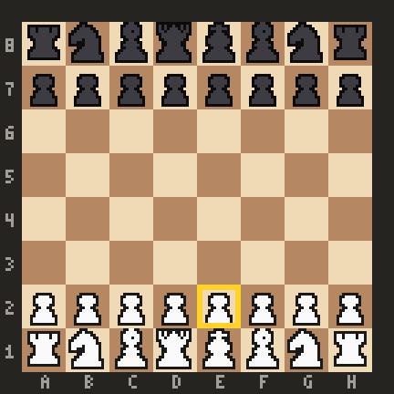

# Console

Play chess in your terminal. Your opponent can be **Claude Code**, **Codex**, **OpenCode**, **Hermes**, Stockfish, or a small built-in engine. Chrome's dino game is in the box too, one command away.



## Install

Python 3.10+ and a terminal that can draw sixel graphics. **Windows Terminal 1.22 or newer** does; so do WezTerm, iTerm2 and foot. There are no Python dependencies.

```bash
pipx install .
# or, from a checkout:
python -m pip install -e .
```

Then start a game in the current terminal:

```bash
console chess
```

## Use it from your agent

Claude Code, Codex and OpenCode own the terminal they run in: they have no supported way to pause their UI and hand it to another program. So Console opens **next to** the session, and on Windows Terminal (or tmux) it can fill the window over the agent, so it feels like Hermes: one key in, `Esc` back out.

```bash
console install claude     # ~/.claude/commands/console.md + console-dino.md
console install codex      # ~/.codex/prompts/console.md + console-dino.md
console install opencode   # ~/.config/opencode/commands/...
console install all        # all three
```

The installer is idempotent, tells you every path it writes, and refuses to overwrite a file it did not create (use `--force`). Add `--project` to put the command in this repository instead of your user config (Claude Code and OpenCode; Codex prompts are always user-level). Use `console install --list` to see the paths. After upgrading Console, run `console install all` again to refresh older command files; each command pins chess to its host, so OpenCode shows OpenCode models, Codex shows Codex models, and so on.

| Host | Type | What it does |
| --- | --- | --- |
| Claude Code | `/console` | opens chess in a new pane; `/console-dino` opens the dino |
| Codex | `/prompts:console` | same (older builds may show `/console`) |
| OpenCode | `/console` | same |
| Hermes | `/console` | plays **in place**, and `Ctrl+O` opens it any time, even while the agent works |
| Any terminal | `console install terminal --apply` | binds `Ctrl+O` to a full-window game over the agent |

Under the hood `console open chess` finds the terminal you are already in (Windows Terminal, iTerm2, tmux, WezTerm, kitty, Alacritty, GNOME Terminal, Konsole, foot) and splits it. When it cannot find one it prints the command to run instead.

### One key to the whole window

Run the agent inside **Windows Terminal** (or tmux), then bind the key once:

```bash
console install terminal --apply
```

That edits Windows Terminal's `settings.json` for you — it is idempotent, writes `settings.json.console.bak` first, and refuses to touch a file it cannot parse as plain JSON. The result is `Ctrl+O` → a split pane running `console chess` → zoomed to fill the window. Play, then quit (or press `Ctrl+O` again to unzoom, then close the pane) and the agent is exactly where you left it, still running.

On tmux, add one line and the same key opens chess in a full-screen popup:

```tmux
bind-key -n C-o display-popup -E -w 90% -h 90% 'console chess'
```

`console install terminal` without `--apply` prints both snippets if you would rather paste them yourself.

### Hermes

```bash
hermes plugins install Takumixbt/Console --enable
```

Restart Hermes; `/help` lists `/console`. Hermes is the one host that can hand the terminal over in place, so the game pauses and resumes with the agent, and a line under the board tells you when the agent is working and when it finished. Set `CONSOLE_HOTKEY` (for example `c-g`) to change the key.

From a local checkout on Windows, a directory junction is enough (no admin rights needed):

```powershell
$dst = "$env:LOCALAPPDATA\hermes\plugins\console"
New-Item -ItemType Directory -Force -Path (Split-Path $dst) | Out-Null
cmd /c mklink /J "$dst" "C:\path\to\Console"
hermes plugins enable console
```

### Claude Code, Codex and OpenCode as the *opponent*

You do not need API keys for this. The chess menu lists every agent CLI it finds on your `PATH`; picking one runs it in non-interactive mode (`claude -p`, `codex exec`, `opencode run`) with the login already on the machine, reads back a legal move, and retries if the reply is not one. It runs in a scratch directory, so it cannot touch your project while it thinks about a move.

```bash
console chess
# Opponent: Claude Code / Codex / OpenCode / Stockfish / Built-in engine / API model
```

Set `CONSOLE_CLAUDE_MODEL`, `CONSOLE_CODEX_MODEL` or `CONSOLE_OPENCODE_MODEL` to pin a model for that opponent. Expect a few seconds per move.

## Opponents

- **Built-in engine**: a small alpha-beta engine in pure Python, four strengths from Beginner to Strong.
- **Stockfish**: used automatically when `stockfish` is on your `PATH` (or `CONSOLE_STOCKFISH` points at it).
- **Claude Code / Codex / OpenCode**: the coding agent you already use, in print mode.
- **Hermes model**: the model Hermes is running, through the plugin's `ctx.llm`. The menu lists every provider and model Hermes has credentials for (the same list as `/model`); pick one with Left/Right, `,` and `.` jump ten at a time.
- **API model**: any OpenAI-compatible endpoint (OpenRouter, Groq, Ollama, LM Studio, vLLM...) or Anthropic's Messages API:

  ```bash
  export CONSOLE_LLM_MODEL=qwen3
  export CONSOLE_LLM_BASE_URL=http://localhost:11434/v1   # optional for OpenAI itself
  export CONSOLE_LLM_API_KEY=...                          # not needed for a local server
  # export CONSOLE_LLM_PROTOCOL=anthropic                 # or let the URL decide
  ```

Hermes only lets a plugin choose its own model when you allow it, so add this to `config.yaml` for the provider/model rows:

```yaml
plugins:
  entries:
    console:
      llm:
        allow_provider_override: true
        allow_model_override: true
        allowed_providers: ['*']
        allowed_models: ['*']
```

Without it chess still works, but only with the model Hermes is running.

## Playing chess

Arrow keys move the cursor, `Enter` picks up a piece and puts it down (legal squares are dotted, captures are ringed), `Backspace` cancels, `U` takes a move back, `F` flips the board, `N` starts a new game, `R` resigns, `Esc` leaves.

Castling, en passant, promotion, check, checkmate, stalemate, insufficient material, threefold repetition and the fifty-move rule are all handled. The rules code is checked against the standard perft node counts for seven well-known test positions.

## The dino

Chrome's offline game is still here, as an add-on: `console dino`, `/console-dino` in an agent, or `python -m console --demo` to watch it play itself.


`Space` or `Up` starts and jumps (hold for a higher jump), `Down` ducks, `Enter` restarts, `Esc` leaves. It is a line-for-line port: `tools/chrome_trace.mjs` runs the real dino page in headless Chrome under a fake clock and hashes every canvas call, and `tools/replay_trace.py` compares about 100,000 frames of the Python version against it.

## Configuration

| Variable | Meaning |
| --- | --- |
| `CONSOLE_HOME` | where `console.json` (high scores) lives |
| `CONSOLE_SIXEL=1` / `0` | force sixel on or off if your terminal does not announce it |
| `CONSOLE_HOTKEY` | the Hermes hotkey (default `c-o`) |
| `CONSOLE_SOUND=0` | mute the dino |
| `CONSOLE_DEBUG=1` | frame rate and timing under the picture |
| `CONSOLE_TERMINAL` | the terminal program `console open` should use (e.g. `wezterm`) |
| `CONSOLE_CLAUDE_MODEL`, `CONSOLE_CODEX_MODEL`, `CONSOLE_OPENCODE_MODEL` | pin a model per agent opponent |
| `CONSOLE_CHESS_MODEL`, `CONSOLE_CHESS_PROVIDER` | the Hermes menu's default model |
| `CONSOLE_LLM_MODEL`, `CONSOLE_LLM_BASE_URL`, `CONSOLE_LLM_API_KEY`, `CONSOLE_LLM_PROTOCOL` | the API opponent |
| `CONSOLE_STOCKFISH` | path to a Stockfish binary |

## Troubleshooting

- *"this terminal did not say it supports sixel"*: use Windows Terminal 1.22+ (or WezTerm, iTerm2, foot). `CONSOLE_SIXEL=1` forces it on if your terminal supports sixel but does not announce it.
- *The picture is small*: it is drawn at the largest whole-number scale that fits, so every game pixel stays square. Enlarge the window or lower the font size and it grows.
- *`/console` in Claude Code, Codex or OpenCode did nothing*: run `console open chess` yourself in a shell and read the message. `console install --list` shows where the command files live.
- *`Ctrl+O` does nothing*: the keybinding only exists inside Windows Terminal, not in VS Code's terminal or a plain console. Check `console install terminal --apply` succeeded, and that Windows Terminal reloaded `settings.json` (it does so automatically when saved). If `console` is not on the PATH seen by new panes, edit the binding's `commandline` to the full path.
- *Choppy*: `console --debug` prints the frame rate and where the time goes under the picture.

## Development

```bash
python -m pip install -e ".[dev]"
python -m pytest                                             # includes the Chrome parity tests (about 2 minutes)
node tools/chrome_trace.mjs --frames 20000 --out trace.json  # needs Chrome and Node 22+
python tools/replay_trace.py trace.json
```

## Layout

```
plugin.yaml, __init__.py   Hermes plugin entry
console/hermes_plugin.py   /console, the hotkey, the "agent is working" line
console/hosts.py           console open / console install for other agent CLIs
console/runner.py          the screen loop (layout, keys in, pictures out)
console/terminal.py        console input with real key-up, probing, background writer
console/gfx/               PNG decoder, canvas, sixel encoder
console/games/chess/       rules, engine, opponents (engine, Stockfish, agent CLIs, API) and the board
console/games/dino/        the port of Chromium's dino game, plus sounds and a demo autopilot
tools/                     the Chrome trace recorder and the replay checker
```

Another game plugs in under `console/games/` with the `@register("name")` decorator and opens with `console <name>` or `/console <name>`.

## Credits

The dino sprites, sounds and game logic come from the Chromium project. Console itself is MIT.
